  &nbsp;
  &nbsp;
  

### About

I'm a software engineer at **[Bounce Insights](https://www.bounceinsights.com)**, an AI market research company in Dublin. I design services, write them, ship them and keep them running on AWS, and more and more of that work is AI: retrieval that grounds answers in real data, and agents built on ADK that plan and call tools.

I started in mechatronics, so I think in whole systems, not single parts. MSc Computer Science from UCD.

### Activity

### Selected work

Products I build end to end, outside my day job, plus earlier research work.

  
  
  
  

### Stack

Every image here is an SVG in this repo, built by <code>scripts/build.mjs</code>. Activity refreshes daily through GitHub Actions, so nothing depends on a third-party image service.
